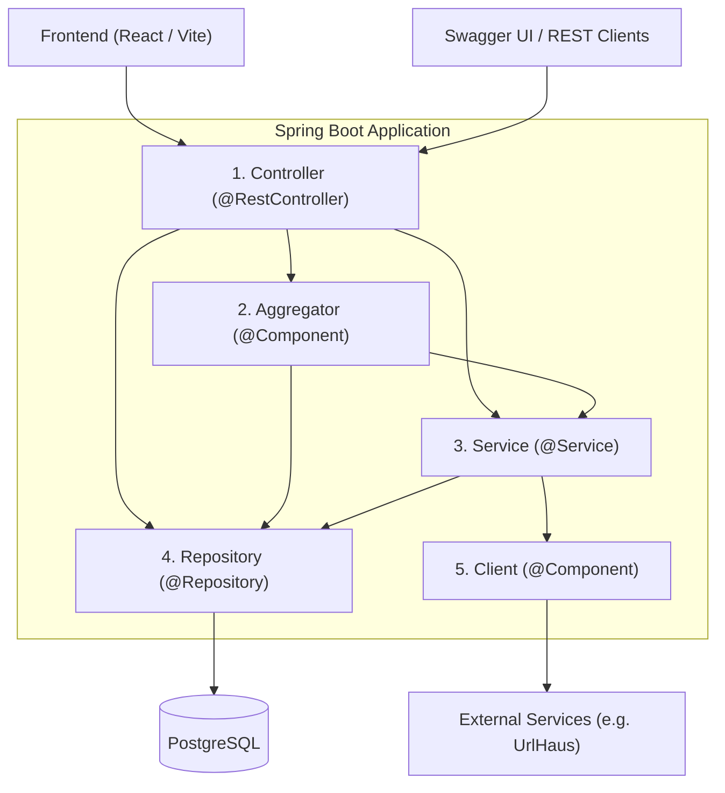

# Howto

A reference community forum application demonstrating clean enterprise Spring Boot architecture and engineering practices: a strict unidirectional layered design, RESTful API structure, JWT-based Spring Security with role-based access control, database migrations with Flyway, outbound integration with threat intelligence (UrlHaus), a modern React single-page frontend, automated test data generation with [test-populator](https://github.com/anhem/test-populator), and full-stack integration testing with Testcontainers and Playwright.

---

## Architecture & Layering

The application enforces a strict unidirectional layered architecture. Each layer has an explicit responsibility, and dependencies only flow downward. Classes in a lower layer **never** call or depend upon classes in the same layer or any layer above, preventing circular dependencies and coupling.



### 1. Controller Layer (`@RestController`)
- **Role:** Exposes REST endpoints, validates incoming HTTP requests, and handles response serialization.
- **Data Models:** Exclusively consumes and returns DTOs (Data Transfer Objects). Domain models are only used when passing arguments down to services.
- **Interactions:** May call **Aggregator**, **Service**, or directly **Repository** (for simple lookups).

### 2. Aggregator Layer (`@Component`)
- **Role:** Coordinates and combines data across multiple services or repositories when composing rich response DTOs, preventing cross-service pollution.
- **Data Models:** Handles both DTOs and domain models.
- **Interactions:** May call **Service** and **Repository**.

### 3. Service Layer (`@Service`)
- **Role:** Encapsulates core business logic and domain rules.
- **Data Models:** Operates strictly on domain/internal models.
- **Interactions:** May call **Repository** and external **Client** components.

### 4. Repository Layer (`@Repository`)
- **Role:** Manages database persistence and queries via Spring JDBC/Templates.
- **Data Models:** Maps database records to domain/internal models. Contains no business logic.

### 5. Client Layer (`@Component`)
- **Role:** Manages outbound communication with third-party APIs (e.g. UrlHaus threat detection).
- **Data Models:** Accepts domain models, constructs external request payloads, and translates responses back into internal models.

---

## Getting Started

### Prerequisites
- **Java 21**
- **Docker & Docker Compose** (for PostgreSQL database and test containers)
- **Node.js 20+ & npm** (only required if building or developing the frontend)

### 1. Start the Database
Run the local PostgreSQL instance via Docker Compose:

```bash
docker compose up -d
```

### 2. Run the Application
Start the Spring Boot backend:

```bash
./mvnw spring-boot:run
```

Once started, the application is accessible at:
- **Web Application:** [http://localhost:8080/](http://localhost:8080/)
- **Swagger UI:** [http://localhost:8080/swagger-ui/index.html](http://localhost:8080/swagger-ui/index.html)
- **OpenAPI Docs:** [http://localhost:8080/v3/api-docs](http://localhost:8080/v3/api-docs)
- **Actuator Health:** [http://localhost:8080/actuator/health](http://localhost:8080/actuator/health)

---

## Authentication & Test Users

The application uses stateless JWT authentication. To access protected endpoints, obtain a token via `POST /api/auth/authenticate` and include it in the `Authorization` header:

```http
Authorization: Bearer <token>
```

### Pre-seeded Accounts

| Username | Password | Role | Privileges |
|---|---|---|---|
| `admin` | `superSecret1!` | `ADMINISTRATOR` | Full access: manage accounts, categories, and forum content |
| `moderator` | `superSecret2!` | `MODERATOR` | Create and edit categories, moderate posts and replies |
| `user` | `superSecret3!` | `USER` | Standard forum participation: browse, create posts, and reply |

### Role Permissions & Capabilities

| Capability | Unauthenticated | `USER` | `MODERATOR` | `ADMINISTRATOR` |
|---|:---:|:---:|:---:|:---:|
| Public Endpoints & Swagger / OpenAPI | ✅ | ✅ | ✅ | ✅ |
| Authenticate / Self-Register | ✅ | ✅ | ✅ | ✅ |
| Browse Categories, Posts & Replies | ❌ | ✅ | ✅ | ✅ |
| Create Posts & Replies | ❌ | ✅ | ✅ | ✅ |
| Edit / Delete Own Posts & Replies | ❌ | ✅ | ✅ | ✅ |
| Create & Update Categories | ❌ | ❌ | ✅ | ✅ |
| Moderate (Edit/Delete) Any Post or Reply | ❌ | ❌ | ✅ | ✅ |
| Delete Categories | ❌ | ❌ | ❌ | ✅ |
| Manage Accounts (View, Provision Roles, Change Roles, Delete) | ❌ | ❌ | ❌ | ✅ |

#### Role Summary
- **`USER` (`ROLE_USER`):** Default role for self-registered accounts. Can browse forum categories, create discussion posts, submit replies, and edit or delete their own posts and replies.
- **`MODERATOR` (`ROLE_MODERATOR`):** Content and category governance. Inherits all `USER` permissions, can create and update categories, and can edit or delete any post or reply across the forum.
- **`ADMINISTRATOR` (`ROLE_ADMINISTRATOR`):** Full system administration. Inherits all `MODERATOR` permissions, can permanently delete categories, and manages user accounts (viewing profiles, provisioning accounts, changing assigned roles, and deleting accounts).

### Example Authentication Request

```bash
curl -X POST http://localhost:8080/api/auth/authenticate \
  -H "Content-Type: application/json" \
  -d '{"username": "admin", "password": "superSecret1!"}'
```

---

## Frontend

The frontend is a lightweight Single Page Application (SPA) built with **React 19**, **TypeScript**, and **Vite**, featuring **TanStack React Query** for server state management and responsive vanilla CSS design.

### Production Build & Delivery
The build is automated by `frontend-maven-plugin` during the Maven lifecycle:
- Vite compiles and outputs assets to `frontend/dist/`.
- `maven-resources-plugin` copies `frontend/dist/` into `${project.build.directory}/classes/static/`.
- No generated or minified assets are stored in `src/`.
- Spring Boot packages `target/classes/static/` into the JAR and serves it automatically on port 8080.

To build the entire project (backend + frontend):

```bash
./mvnw package
```

### Local Development Mode
For live editing with Hot Module Replacement (HMR):

```bash
cd frontend
npm run dev
```

The Vite dev server runs at [http://localhost:5173](http://localhost:5173) and automatically proxies `/api` calls to the Spring Boot backend on port 8080.

### Frontend Unit & Component Tests
Component tests are implemented using **Vitest** and **React Testing Library** with `@testing-library/user-event`:

```bash
cd frontend
npm test
```
These tests are also executed automatically during Maven's `test` phase.

---

## Testing

The project employs a comprehensive test strategy covering unit tests, integration tests with real databases, and automated browser click tests.

### Running Tests

```bash
# Run all tests
./mvnw test

# Run Playwright browser click tests
./mvnw test -Dtest=FrontendClickIT

# Run security filter chain verification
./mvnw test -Dtest=SecurityConfigIT
```

### Test Strategy
- **Automated Test Data Generation (`test-populator`):** Uses [test-populator](https://github.com/anhem/test-populator) via `TestPopulator.populate(...)` to automatically instantiate deep object graphs, DTOs, and domain models across unit and integration tests without boilerplate.
- **Playwright End-to-End Click Tests (`FrontendClickIT`):** Launches a headless Chromium browser using Playwright against a live Spring Boot instance and PostgreSQL Testcontainer, testing the full user journey (sign-in, category management, post creation, and threaded replies).
- **Security Tests (`SecurityConfigIT`):** Uses reflection across all `@RequestMappingHandlerMapping` endpoints to verify that unauthenticated access is strictly forbidden on non-whitelisted routes.
- **Integration Tests (`*IT`):** Use **Testcontainers** (`PostgreSQLContainer`) with Flyway migrations to run tests against an isolated, production-grade database.

---

## Database Management & Flyway

Database migrations are managed using Flyway. Migrations reside in:
- `src/main/resources/db/migration/common/`: Schema definitions applied across all environments.
- `src/main/resources/db/migration/local/`: Seed scripts for local development and test users.

### Updating the Baseline
To accelerate test execution and local startup, a database dump serves as the baseline in `src/test/resources/db/baseline/howto_db_baseline.sql`.

To regenerate the baseline:
1. Temporarily remove local seed scripts from `src/main/resources/db/migration/local/`.
2. Reset the database:
   ```bash
   docker compose down -v
   docker compose up -d
   ```
3. Start the application with the `local` profile to run common migrations.
4. Dump the clean schema:
   ```bash
   PGPASSWORD=password docker exec howto-postgres pg_dump -U howto -d howto-db > howto_db_baseline.sql
   ```
5. Move `howto_db_baseline.sql` to `src/test/resources/db/baseline/howto_db_baseline.sql`.
6. Restore the local seed scripts in `src/main/resources/db/migration/local/`.
